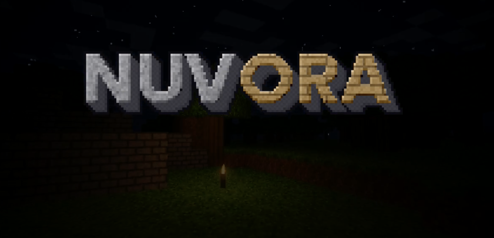

# VoxelCraft Survival

A multiplayer voxel survival game that runs in the browser, built with Three.js, Node.js (Express) and WebSocket.

## Features

- Procedurally generated chunked world with biomes: plains, mountains, lakes and giant forests
- Survival mechanics: health, hunger, air, day/night cycle, zombies
- Mining, building, crafting (2x2 and 3x3), tools with durability
- 36-slot inventory with drag and drop, hotbar, recipe book
- Chests, torches with dynamic lighting, sheep and wool
- Multiplayer with live block sync and chat
- Desktop and mobile controls

## Requirements

See [`requirements.txt`](requirements.txt). In short: Node.js 18+ and npm. Three.js (r128) is loaded from a CDN, so an internet connection is needed in the browser.

## Getting started

```
npm install
npm start
```

Then open http://localhost:3000. Use the `PORT` environment variable to change the port:

```
PORT=8080 npm start
```

## Project structure

Client files live in `public/` and are loaded in this order:

| File | Purpose |
| --- | --- |
| `game.js` | Engine: chunks, noise, raycasting, networking |
| `terrain.js` | World generation and biomes |
| `textures.js` | 16x16 procedural texture atlas, meshes, icons |
| `menu.js` | Title screen and splash texts |
| `items.js` | Items, inventory, recipes, tool durability |
| `physics.js` | Player physics: inertia, sprint, sneak, water, collisions |
| `hand.js` | First-person hand with held item, sway and swing |
| `entities.js` | Dropped items with physics and magnet pickup, zombies |
| `animals/` | Animal framework and sheep |
| `ui.js` | Hotbar, vitals, inventory, crafting |
| `survival.js` | Health, hunger, air, mining, day/night, death, saving |
| `atmosphere.js` | Sky, atmosphere effects, particles, water and foliage shaders |
| `torch.js` | Torches and dynamic lights |
| `chest.js` | Chest storage |

`server.js` serves the client and syncs players and blocks over WebSocket.

## Controls

| Key | Action |
| --- | --- |
| W A S D | Move |
| Double W | Sprint |
| Shift | Sneak |
| Space | Jump / swim |
| Left click (hold) | Mine / attack |
| Right click | Place block / eat / open crafting table or chest |
| 1-9 or mouse wheel | Select hotbar slot |
| E | Inventory |
| Q | Drop item |
| F | Eat |
| T | Chat |

Mobile: joystick on the left, drag to look around, on-screen buttons for jump, break and place.

## Inventory

Left click picks up or places the whole stack, right click picks up half or places one item. Crafting is shapeless (see the recipe book inside the inventory). Right click a crafting table for the 3x3 grid and tools. Stone only drops cobblestone when mined with a pickaxe.

## Saving

The server stores world edits in `world.json` and chest contents in `chests.json`. Zombies, health and inventory are stored locally in each player's browser (localStorage).

## Contact

Contact me at https://discord.gg/uMCWjqDr7N
## Showcase


